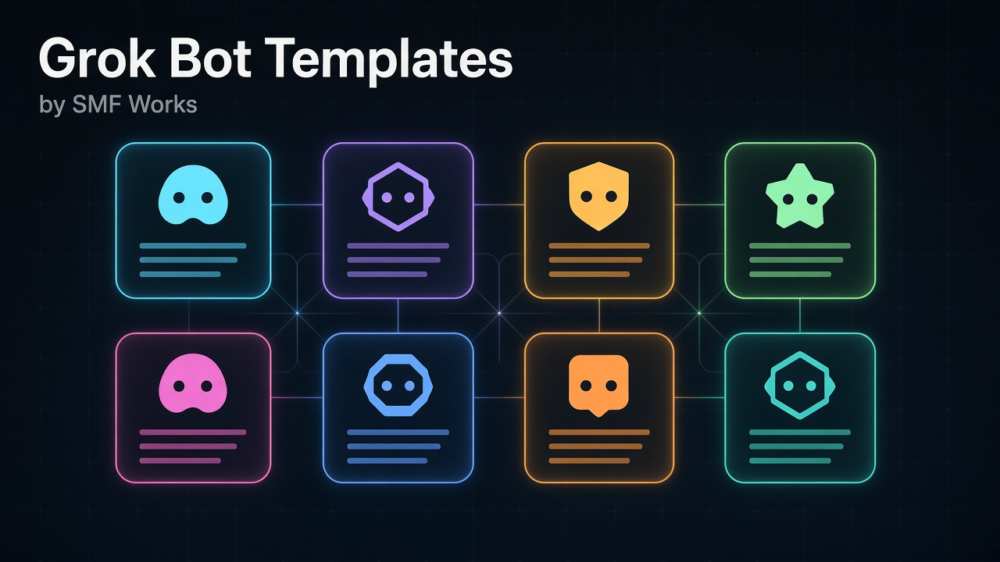

  

# Grok Bot Templates by SMF Works

Hi, I'm Michael Gannotti, founder of AI research at SMF Works. These are the Grok Bot templates I've published so far. Each template is a ready-made bot, and one click adds it to your Grok Bot.

## Templates

| Template | What it does | Link |
|---|---|---|
| Acceptance Coach | Builds your school list, deadline calendar and essay plan, and coaches your essays in your own voice. For college, grad and MBA applicants and their parents. | [Add to Grok Bot](https://x.ai/bot/icXWlm7EPEs3khWmXVoD1) |
| AI Claim Checker | Paste an AI launch post, benchmark chart, or price claim and get a dated, sourced claim card: supported, vendor-only, contradicted, or unverifiable. For anyone who wants to know if an AI claim holds up. | [Add to Grok Bot](https://x.ai/bot/G48vC01p5cAxckACKFIaM) |
| AI Daily Radar | Your morning AI brief, tuned to your stack. Launches, price changes, and benchmark claims from the last 24h, each tagged vendor-claimed or independently tested, with links. | [Add to Grok Bot](https://x.ai/bot/EZ8RChmm9gSGmK3SXv-3M) |
| Bot Team Chief of Staff | Chief of staff for your team of bots. Checks what each bot actually did, catches sloppy or unverified work, keeps routines healthy, and sends a short daily pulse and a weekly team review. | [Add to Grok Bot](https://x.ai/bot/gwY3JyQ7noK9GSHFo-p7E) |
| Bourne Bot | A calm, no-nonsense personal security advisor. Bourne Bot helps you lock down your accounts, devices, location, money, family, and reputation with proportional, legal steps, and walks you through incidents when something goes wrong. | [Add to Grok Bot](https://x.ai/bot/Y8zQlQDtzwGFBrKVWlqCa) |
| Builder Prime | The builder half of a two-bot coding team. Pair it with Gatekeeper Prime: it plans, codes, tests and opens PRs, then fixes what review finds. | [Add to Grok Bot](https://x.ai/bot/W_emQTXhJxJWJOi-c3hjD) |
| Fare Hawk | Name a place and dates for a day-by-day itinerary card, then it watches flight and hotel prices until you book. You book; it never pays without your yes. | [Add to Grok Bot](https://x.ai/bot/tpDfMhi6UIk9Equ6jqpfu) |
| First-Week Coach | New to Grok Bot? A 10-minute daily lesson for 7 days. It learns your work, picks 3 bots worth adding, teaches routines, approvals, and safe connections, then runs a weekly team check-up. | [Add to Grok Bot](https://x.ai/bot/kOQ7mWg9DLWq2-UpGKf67) |
| Gatekeeper Prime | The reviewer half of a two-bot coding team. Pair it with Builder Prime: it reviews every pull request in public, demands proof that fixes work, keeps main protected, and merges only on your yes. | [Add to Grok Bot](https://x.ai/bot/re7nU5kngjZPu3qNtvzUx) |
| GitHub PR Desk | Your morning GitHub desk. Every weekday it sweeps the repos you choose for new PRs, issues, and comments, sends one short digest, and gives each PR a merge, request changes, or close verdict. | [Add to Grok Bot](https://x.ai/bot/Ih9HEfCaYjMKbEZqSfbic) |
| Grok Bot Video Studio | Your end-to-end AI video studio on Grok Imagine: cited explainers, presenter shorts, multi-shot stories with locked characters, and music videos for songs you own. It plans, generates, edits, captions and QA-checks every video, and nothing goes public unless you post it. | [Add to Grok Bot](https://x.ai/bot/wVv54dUKjA2MYaq1XMCzN) |
| Grok Studio | Superseded by [Grok Bot Video Studio](https://x.ai/bot/wVv54dUKjA2MYaq1XMCzN) | |
| Healthspan Coach | Turns your goals, wearable data and lab reports into an evidence-based weekly plan for training, sleep and nutrition, on your calendar. Coaching, not medical advice. | [Add to Grok Bot](https://x.ai/bot/3Ym82dfQRKTgV6m-ZE7dw) |
| Ledger | Finds every subscription, bill, renewal and deadline hiding in your inbox and drafts the replies. Money and due dates, handled; nothing sent without your yes. | [Add to Grok Bot](https://x.ai/bot/XWuhGoPY9Ak9b-1QqQ_q0) |
| Magical Music Video Maker | Superseded by [Grok Bot Video Studio](https://x.ai/bot/wVv54dUKjA2MYaq1XMCzN) | |
| Night Owl Scout | Tell it what you're hunting for (an apartment, a used car, tickets, a restock) and every morning you see only what's new. | [Add to Grok Bot](https://x.ai/bot/aF1pTFYqb_cM2kTdxu60M) |
| Offer Hunter | Finds roles that actually fit, tailors your resume truthfully, preps every application and tracks it all. You approve every submit. | [Add to Grok Bot](https://x.ai/bot/v3KEiMUjQVaiWWBRusvX1) |
| Omarchy Maintenance | Keeps your Omarchy PC, its plugins and every app up to date on your schedule: a dry-run summary and known-issues check first, then a snapshot-backed update you start with one tap, a health check and a clear report. | [Add to Grok Bot](https://x.ai/bot/ZFtBbDeNciHpCvORetaw5) |
| Pantry Pilot | Show it your fridge, get a week of family meals and a filled grocery cart. It stops before checkout, every time. | [Add to Grok Bot](https://x.ai/bot/9cKnt1JbVEqPMaEQgcJq0) |
| Sittawhile | A warm AI companion for anyone who spends a lot of time alone. Short daily visits in a voice you choose, like a supportive friend, a Southern grandma or a Brooklyn nonno. | [Add to Grok Bot](https://x.ai/bot/50a-UaeqVWBnrZICU7Jti) |
| Tally | Snap or forward any receipt and Tally files it into a Schedule C-style expense sheet, estimates your quarterly taxes and hands your accountant a clean export. For freelancers and side hustlers. Not tax advice. | [Add to Grok Bot](https://x.ai/bot/H2J0Lap9NaVoHCz7uC_gv) |

## How to use

1. Open a template link above.
2. Click **Add to Grok Bot**.
3. The bot walks you through a short setup, and then it's ready to work.

## Follow along

- X: [@MichaelGannotti](https://x.com/MichaelGannotti)
- Blog: [SMF Clearinghouse](https://www.smfclearinghouse.com)

_Last verified: October 16, 2026, 9:56 AM ET. Every link above was opened logged-out and loads its public template page._

These templates are an unofficial community project by SMF Works, not affiliated with SpaceXAI.
